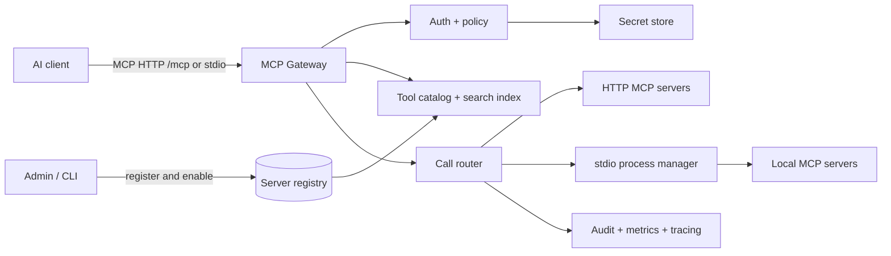
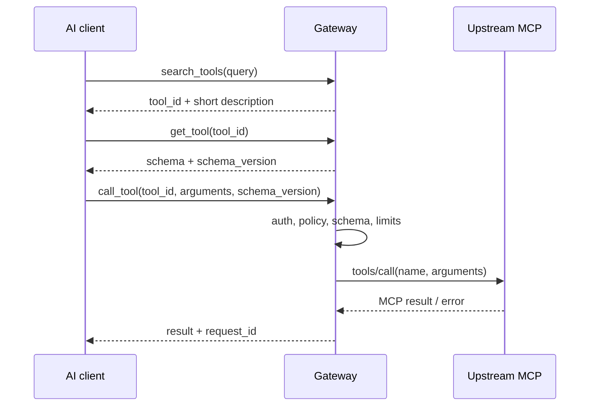

# MCP Gateway Design: Register, Discover, and Call Tools Across MCP Servers

Status: architecture and roadmap; an initial implementation is in `src/` · October 30, 2026

## Goal

Build an internal service that connects multiple MCP servers over stdio or Streamable HTTP, then exposes the same tools to AI clients over HTTP or stdio. A user or agent can discover permitted tools, inspect their schemas, and call them through the Gateway. Access control and auditing are centralized.

The core pattern is **discover before calling**. The Gateway initially exposes a small, stable set of tools rather than placing every upstream tool schema in the model's context. Clients that need individual tools can use the expanded mode proposed below.

## Scope and key choices

| Area | Initial approach | Reason |
| --- | --- | --- |
| Inbound transport | MCP Streamable HTTP at `/mcp`, or stdio | Clients can use a shared endpoint or launch the Gateway locally |
| Outbound transport | Streamable HTTP and stdio | Covers remote services and local processes |
| Tool exposure | Discovery mode first; expanded mode later | Limits context size while leaving a path for clients that require direct tool definitions |
| Server inventory | Private organizational catalog | Deployment approval stays separate from public discovery |
| Search | Keywords and metadata filters first; semantic search later | Simple to operate and measure without embeddings |
| Authorization | Check server and tool permissions on every call | A previous search result is not ongoing authorization |
| Installation | Administrators register and test manifests before enabling them | MCP servers are executables or services with access to data |

### Tool exposure modes

1. **Discovery mode (implemented):** Gateway `tools/list` returns `search_tools`, `get_tool`, and `call_tool`. A restricted `list_servers` tool is a possible future addition. The caller searches first, then uses the returned `tool_id`.
2. **Expanded mode (planned):** Gateway `tools/list` returns all permitted upstream tools with namespaced names such as `github__search_issues` and their original schemas. This helps clients that cannot use a generic `call_tool`. It needs a tool-count limit and pagination.

Both modes must use the same catalog and policy. Unauthorized tools must never appear in search results or in expanded listings.

## Architecture



The Gateway is an **MCP server** to inbound clients and an **MCP client** to each upstream. It uses the MCP SDK and the appropriate transport on each side. It is not a transparent HTTP reverse proxy: it must handle tool naming, authorization, legacy sessions, streamed results, and errors. The current stdio entry point trusts the launching host and uses `MCPX_STDIO_GROUPS` to scope visible tools.

The diagram includes planned components. The current implementation uses a JSON manifest, environment variables for credentials, and a JSONL audit log. It starts a new stdio process for each listing or call; a long-lived process manager is future work.

## Gateway tool contracts

### `search_tools`

Current input: `{ "query": "search GitHub issues", "limit": 5, "server": "github" }`. `server` is optional. A future `capability` filter could distinguish read and write operations.

Each current result contains `tool_id`, `title`, a short `description`, `server_id`, `schema_version`, and a search score. Do not put secrets or full schemas in search results. Planned metadata includes capabilities and risk classification.

Initial ranking gives priority to exact names, then names containing the query, titles, and descriptions. Filter by authorization before ranking. Limit result counts. Add semantic ranking only when real search data shows a measurable need.

### `get_tool`

Input: `{ "tool_id": "github/search_issues" }`

Output includes the description, `inputSchema`, optional `outputSchema`, annotations, and `schema_version`. Future versions may add curated examples and policy requirements. Recheck authorization. Treat upstream descriptions and annotations as untrusted data.

### `call_tool`

Input: `{ "tool_id": "github/search_issues", "arguments": { "query": "is:open" }, "schema_version": "sha256:..." }`

The Gateway authenticates the caller, checks access, refreshes the selected tool definition, verifies its schema version, validates `arguments` against JSON Schema, and calls the upstream `tools/call`. It returns the upstream content, structured content, and `isError` status. The call receives a `request_id` for audit correlation. A schema mismatch returns `SCHEMA_CHANGED` so the caller can use `get_tool` again. Transport, policy, and tool execution failures should remain distinguishable.

The Gateway creates stable IDs such as `<server_id>/<tool_name>`. The manifest defines `server_id`; an upstream server's self-reported name is not unique enough. Expanded mode will need safe aliases for tool names that cannot be exposed directly, plus a mapping back to upstream names.

## Registering and installing internal MCP servers

Proposed lifecycle: `draft → validate → test → enabled → disabled/removed`. A manifest or package change should be retested before the catalog snapshot is replaced atomically.

Conceptual manifest for a future managed registry:

```yaml
id: github
display_name: GitHub MCP
transport: streamable_http
endpoint: https://mcp.internal.example/github/mcp
auth:
  mode: service_credential # or delegated_user
  secret_ref: secret://mcp/github
visibility:
  groups: [engineering]
  tools:
    allow: [search_issues, get_issue]
limits:
  timeout_ms: 15000
  max_concurrency: 10
```

The current JSON manifest uses `id`, `endpoint`, `allowTools`, `groups`, `credentialEnv`, `headersFromEnv`, and `timeoutMs`. For stdio it uses an absolute `command`, an `args` array, optional absolute `cwd`, and `envFromEnv`. The future managed design should also pin executable versions or digests, enforce an executable allowlist, obtain secrets from a secret store, and limit process resources. It must never interpolate shell commands from manifest fields or install packages because a model requested it.

Proposed validation flow: check the endpoint or executable → connect through the MCP SDK → inspect protocol and capabilities → read every `tools/list` page → validate schemas and names → detect collisions → run only explicitly approved safe test calls → save a catalog snapshot and hash → enable the server. Refresh when list-change events arrive or cache entries expire. If an upstream is down, retain the last metadata for diagnostics but never report a failed call as successful.

The public MCP Registry may become a source of installation candidates. A registry listing alone must not authorize internal installation or calls. Every candidate still needs a reviewed manifest, a pinned version, permission checks, and testing.

## Call flow



Preserve text, image, audio, resource links, and structured content rather than flattening them into one string. Set result-size limits and indicate truncation. If an upstream returns `input_required`, a task, or another capability the Gateway or client cannot handle, return an explicit unsupported status instead of pretending the work finished.

## Security and operations

- Check identity, tenant, groups/scopes, and policy during listing and searching **and again before calling**. Partition catalog caches by authorization scope; never reuse one tenant's results for another.
- Obtain upstream credentials from a secret store in a managed deployment. For user-delegated calls, use a token issued for that upstream. Never forward a token issued to the Gateway as an upstream token.
- Require HTTPS for remote HTTP upstreams, allowlist destinations, and prevent redirects to unapproved destinations. Validate inbound `Origin` and authenticate clients.
- Run stdio servers with low privileges in a sandbox or container, limiting filesystem, network, process, CPU, and memory access. Pin executable or image versions.
- Classify read and write tools through administrator policy. Upstream metadata and annotations are hints, not proof of safety. Operations with external or hard-to-reverse effects need approval in the client or host under organizational policy.
- Apply timeouts, concurrency limits, rate limits, circuit breakers, and cancellation. Retry only confirmed idempotent reads or requests for which the upstream supports an idempotency key.
- Audit caller, tenant, tool ID, upstream, timestamp, latency, status, and `request_id`. Redact sensitive arguments and results. Propagate trace context where supported.
- Provide admin commands or pages for `list`, `inspect`, `test`, `enable`, `disable`, and `logs`, plus health, error-rate, latency, and tool-count dashboards.

These are production design targets. The current MVP implements a narrower subset documented in the README.

## Proposed stored data

| Entity | Key fields |
| --- | --- |
| `servers` | id, transport, endpoint or executable reference, status, owner, manifest version, health |
| `tools` | server ID, upstream name, Gateway alias, schema, schema hash, tags, policy class, last seen |
| `policies` | principal, group or tenant, server/tool pattern, permitted actions, approval rule |
| `credentials` | Secret reference only; no secret values in the catalog |
| `call_audit` | request ID, caller, tool ID, timestamp, outcome, latency, redacted metadata |

A relational database can hold the registry, policy, and audit records. Start search with a full-text index. Add a vector database only if measured keyword-search failures justify it.

## Development phases

1. **MVP:** Gateway MCP endpoint, HTTP upstreams, JSON manifest, `search_tools`/`get_tool`/`call_tool`, keyword search, basic group authorization, audit log, and integration tests with two sample servers. This is implemented.
2. **Internal operations:** A long-lived stdio process manager with resource limits (the current stdio adapter starts a process per operation), a secret store, stronger group policy, admin CLI, health and reconnect handling, automatic catalog refresh, pagination, and expanded mode.
3. **Scale and advanced capabilities:** Semantic ranking based on real queries, approval integration, metrics and tracing, delegated user authorization, tasks, and other capabilities as needed.

### MVP acceptance checks

- Register two HTTP MCP servers that expose the same tool name and route calls to the correct one through `tool_id`.
- Hide unauthorized tools from search and reject direct calls to their IDs.
- Return `SCHEMA_CHANGED` if a tool schema changes between discovery and invocation.
- Return an error with a traceable `request_id` when an upstream fails or times out, without leaking credentials.
- Handle `tools/list`, `tools/call`, pagination, and supported content types with a standard MCP client for the declared protocol version.

The integration tests currently cover name collisions, authorization, schema changes, HTTP header mapping, stdio upstream calls, and a stdio client calling through the Gateway. Some acceptance items above remain production targets.

## MCP protocol versions

The current MVP uses TypeScript MCP SDK 1.32.2 and the `2025-11-25` protocol family with a stateless HTTP transport. Support for revision `2026-07-28` is planned after an SDK upgrade and interoperability testing. The newer revision carries request metadata on every call and has no protocol-level session. Earlier revisions use an `initialize` handshake and may use sessions. Prefer SDK adapters over writing custom session translation.

## References

- [MCP 2026-07-28: Tools](https://modelcontextprotocol.io/specification/2026-07-28/server/tools) — `tools/list`, `tools/call`, pagination, naming, and list changes
- [MCP 2026-07-28: Transports](https://modelcontextprotocol.io/specification/2026-07-28/basic/transports) and [Streamable HTTP](https://modelcontextprotocol.io/specification/2026-07-28/basic/transports/streamable-http) — transport and HTTP requirements
- [MCP 2026-07-28: stdio](https://modelcontextprotocol.io/specification/2026-07-28/basic/transports/stdio) — running servers as subprocesses
- [MCP 2026-07-28: Authorization](https://modelcontextprotocol.io/specification/2026-07-28/basic/authorization) — authorization for HTTP transports
- [MCP 2026-07-28: Versioning](https://modelcontextprotocol.io/specification/2026-07-28/basic/versioning) — modern and handshake-based revisions
- [Official MCP Registry API](https://registry.modelcontextprotocol.io/docs) — possible source of external server candidates
